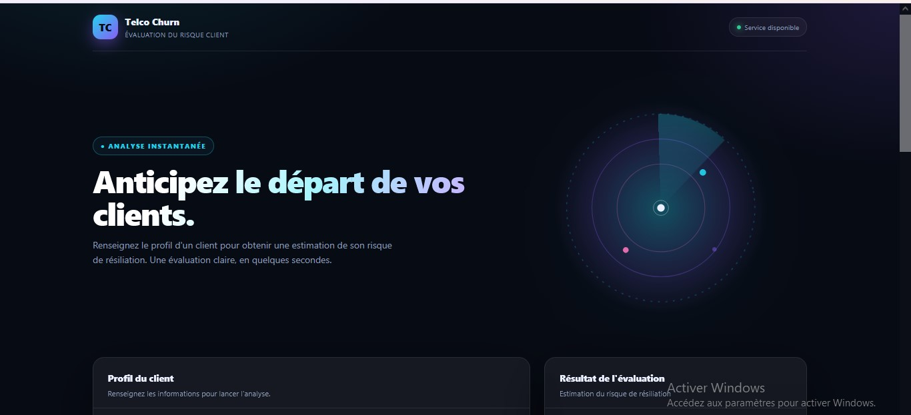
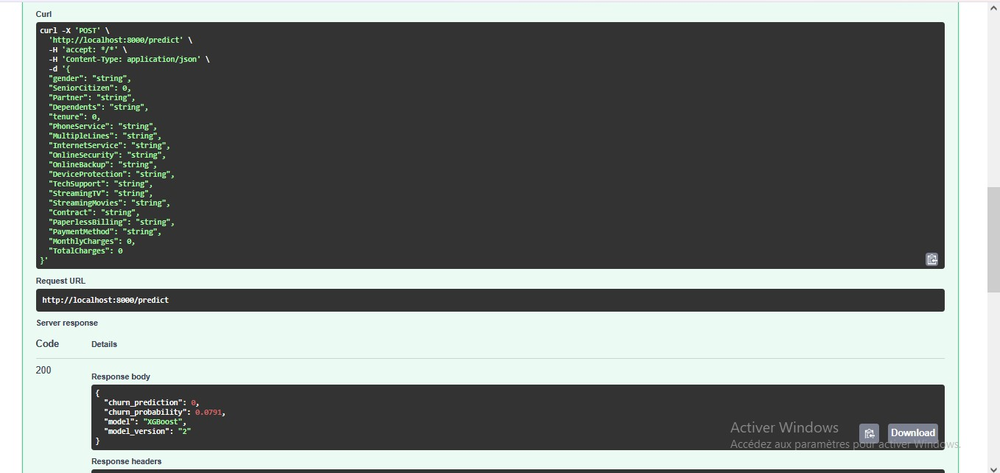
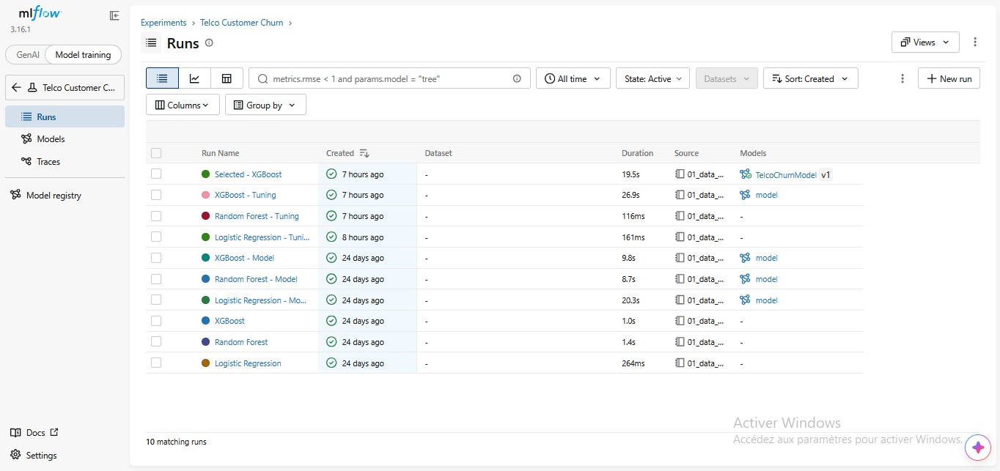
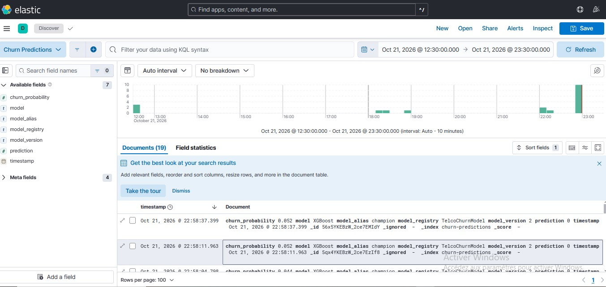

# Telco Customer Churn Prediction & Monitoring — MLOps

An end-to-end MLOps project that predicts customer churn with machine learning. It covers model training, hyperparameter tuning, experiment tracking, model versioning, API deployment, and prediction monitoring.

---

## Table of Contents

- [Overview](#overview)
- [Architecture](#architecture)
- [Tech Stack](#tech-stack)
- [Application Screenshots](#application-screenshots)
- [Machine Learning Workflow](#machine-learning-workflow)
- [MLflow Model Management](#mlflow-model-management)
- [API Endpoints](#api-endpoints)
- [Monitoring](#monitoring)
- [Run Locally](#run-locally)
- [Project Structure](#project-structure)
- [Future Improvements](#future-improvements)
- [Disclaimer](#disclaimer)

---

## Overview

This project implements a complete workflow around the Telco Customer Churn dataset:

1. Explore and preprocess the data
2. Train and compare three models
3. Tune hyperparameters with cross-validation
4. Track experiments and register the best model in MLflow
5. Serve predictions through a FastAPI application
6. Store every prediction in Elasticsearch and monitor it with Kibana

## Architecture


## Tech Stack

| Tool | Role |
| ---- | ---- |
| Python | Data processing and machine learning |
| Pandas / Scikit-learn | Preprocessing, pipelines and evaluation |
| XGBoost | Gradient-boosted tree model |
| MLflow | Experiment tracking, model artifacts and model registry |
| FastAPI | REST API for predictions |
| Docker | Containerized deployment |
| Elasticsearch | Prediction storage |
| Kibana | Data exploration and monitoring |
| HTML / CSS / JavaScript | Prediction interface |

## Application Screenshots

### 1. Customer Churn Prediction Interface

The web interface lets users enter customer information and get a churn prediction from the deployed XGBoost model.



### 2. FastAPI — Interactive API Documentation

FastAPI exposes the prediction endpoint and provides an interactive Swagger interface for testing requests.



### 3. MLflow — Model Tracking and Registry

MLflow tracks experiments, stores evaluation metrics, and manages registered model versions.



### 4. Kibana — Prediction Monitoring

Kibana lets users explore prediction records indexed in Elasticsearch, including the model version and estimated churn probability.



## Machine Learning Workflow

Three models were trained and evaluated:

- Logistic Regression
- Random Forest
- XGBoost

Hyperparameters were optimized with `RandomizedSearchCV` using 3-fold cross-validation and the F1-score as the selection metric.

### Results after tuning

| Model               | CV F1-score | Test Accuracy | Test Precision | Test Recall | Test F1-score |
| ------------------- | ----------- | ------------- | -------------- | ----------- | ------------- |
| Logistic Regression | 0.6330      | 0.7381        | 0.5043         | 0.7834      | 0.6136        |
| Random Forest       | 0.6330      | 0.7701        | 0.5519         | 0.7112      | 0.6215        |
| **XGBoost**         | **0.6361**  | **0.7743**    | **0.5562**     | **0.7406**  | **0.6353**    |

XGBoost was selected for having the best mean cross-validation F1-score.

> These results correspond to the current experimental split and should not be interpreted as guaranteed performance on future data.

## MLflow Model Management

MLflow is used to track experiments, parameters and evaluation metrics, and to manage model artifacts.

The selected model is registered as:

| Property | Value |
| -------- | ----- |
| Registered model | `TelcoChurnModel` |
| Version | `2` |
| Alias | `champion` |

FastAPI loads the model through the MLflow Model Registry rather than from a local artifact.

## API Endpoints

| Endpoint   | Method | Purpose                                  |
| ---------- | ------ | ---------------------------------------- |
| `/`        | GET    | API information                          |
| `/health`  | GET    | API and Elasticsearch health information |
| `/predict` | POST   | Predict customer churn                   |
| `/ui`      | GET    | HTML prediction interface                |
| `/docs`    | GET    | Interactive Swagger documentation        |

The prediction response includes the predicted churn class, the estimated churn probability, the model name and the model version.

## Monitoring

Successful predictions are stored in the Elasticsearch index `churn-predictions`.

Each document contains:

- Timestamp
- Predicted class
- Estimated churn probability
- Model name
- Registered model name
- Model alias
- Model version

Kibana is used to inspect these records and build monitoring visualizations.

## Run Locally

### Prerequisites

- Python 3.13
- Docker Desktop
- Git
- Access to the dataset (see the note below)

### 1. Install Python dependencies

```bash
python -m venv .venv
```

Activate the environment, then install the requirements.

Windows (CMD):

```cmd
.venv\Scripts\activate
pip install -r requirements.txt
```

macOS / Linux:

```bash
source .venv/bin/activate
pip install -r requirements.txt
```

### 2. Start Elasticsearch and Kibana

```bash
docker compose up -d
```

- Elasticsearch: <http://localhost:9200>
- Kibana: <http://localhost:5601>

### 3. Configure MLflow

The current Docker Compose file starts Elasticsearch and Kibana only. The MLflow Tracking Server and the FastAPI service are configured separately in the current development setup.

Before running the API on a new machine, start an MLflow Tracking Server and make the registered model and its artifacts available. The local MLflow database and artifacts are intentionally not stored in Git.

### 4. Access the API

Once FastAPI is running:

- Swagger UI: <http://localhost:8000/docs>
- Prediction interface: <http://localhost:8000/ui>
- Health check: <http://localhost:8000/health>

### Dataset

The project uses the Telco Customer Churn dataset (`data/Telco-Customer-Churn.csv`). Check the source and license of the dataset before redistributing it. If redistribution is not allowed, download it from its original source and place it in the `data/` folder.

## Project Structure

```text
telco-churn-mlops/
├── api/
│   ├── main.py
│   └── static/
│       └── index.html
├── data/
│   └── Telco-Customer-Churn.csv
├── docs/
│   └── screenshots/
│       ├── prediction-ui.png
│       ├── fastapi-swagger.png
│       ├── mlflow-registry.png
│       └── kibana-discover.png
├── models/
│   └── logistic_regression/
├── notebooks/
│   └── 01_data_exploration.ipynb
├── Dockerfile
├── docker-compose.yml
├── requirements.txt
├── .dockerignore
├── .gitignore
└── README.md
```

## Future Improvements

- Integrate FastAPI into Docker Compose for reproducible startup
- Add automated tests and CI/CD with GitHub Actions
- Monitor HTTP request latency and API errors
- Add data drift and model performance monitoring
- Automate model promotion and deployment from the MLflow Model Registry

## Disclaimer

This project is intended for educational and portfolio purposes. Churn probabilities are model estimates and are not guarantees of future customer behavior.
